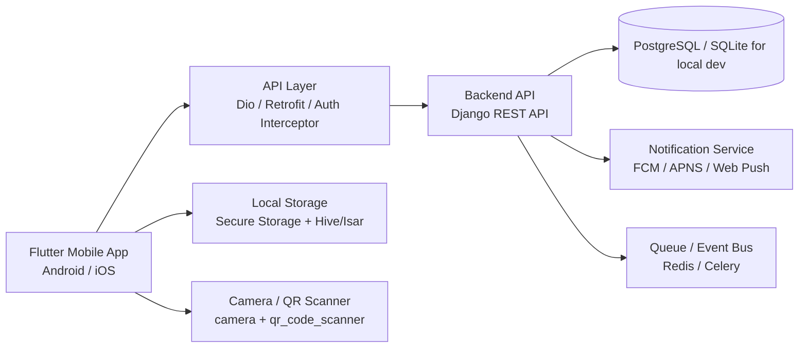

# PPE Management Mobile App (Flutter)

ระบบจัดการ PPE สำหรับโรงงานอุตสาหกรรมที่ออกแบบให้รองรับการเบิกอุปกรณ์คุ้มครองความปลอดภัยส่วนบุคคล (PPE) แบบ mobile-first สำหรับพนักงาน ผู้อนุมัติ คลัง และผู้ดูแลระบบ โดยยึดหลักความปลอดภัย การควบคุมสต็อก และการป้องกันการเบิกซ้ำแบบเรียลไทม์

เวอร์ชันนี้กำลังปรับจากแนวคิดระบบงานปัจจุบัน (Web + Django Backend) ให้กลายเป็นแอปพลิเคชันมือถือที่ใช้งานได้บน Android และ iOS ด้วย Flutter โดยคงโครงสร้าง backend ที่มีอยู่และใช้ API contract เดียวกัน เพื่อให้ทีมพัฒนาสามารถขยายงานได้ต่อเนื่อง โดยไม่ต้องเปลี่ยน business logic หลัก

## 1. ภาพรวมโครงการ

ระบบ PPE Management มีลักษณะสำคัญดังนี้:

- พนักงานสามารถค้นหา PPE, ดูสิทธิ์เบิก, และยื่นคำขอเบิกจากมือถือ
- ผู้อนุมัติสามารถเห็นคำขอจากทีมที่อยู่ภายใต้การดูแลของตนและ approve/reject ได้จากแอป
- คลังสามารถดูสถานะสต็อก, จองสินค้า, จ่ายของ, รับคืน, และติดตาม lot/serial
- ระบบตรวจสอบ anti-duplicate, quota, lifespan, reorder point และลำดับการอนุมัติ
- ใช้ QR Code สำหรับการยืนยันตัวตน, การรับของ, และการตรวจสอบคำขอ
- มีการแจ้งเตือนแบบ push notification และการแสดง dashboard KPI สำหรับผู้ดูแลและผู้อนุมัติ

## 2. เป้าหมายของเวอร์ชัน Flutter

เวอร์ชัน Flutter นี้มีเป้าหมายเพื่อ:

- ทำให้พนักงานใช้ PPE workflow บนมือถือได้ง่ายและเร็ว
- ลดความซับซ้อนของหน้าจอสำหรับคนทำงานภาคสนาม
- บังคับให้ทุกการยื่นคำขอ/อนุมัติ/จ่ายของผ่านกระบวนการที่ตรวจสอบได้
- รองรับการทำงานในสภาพแวดล้อมที่ internet อาจไม่เสถียร
- ใช้สถาปัตยกรรมที่สามารถต่อยอดไปสู่การใช้งานจริงแบบ production ได้

## 3. สถาปัตยกรรมที่แนะนำ

### 3.1 สถาปัตยกรรมระดับระบบ



### 3.2 Layered Architecture ใน Flutter

```text
lib/
├── app/
│   ├── config/
│   ├── constants/
│   ├── routes/
│   ├── themes/
│   └── app.dart
├── core/
│   ├── errors/
│   ├── extensions/
│   ├── network/
│   ├── storage/
│   ├── utils/
│   └── validators/
├── features/
│   ├── auth/
│   │   ├── data/
│   │   ├── domain/
│   │   └── presentation/
│   ├── catalog/
│   ├── requisitions/
│   ├── inventory/
│   ├── approvals/
│   ├── dashboard/
│   ├── notifications/
│   └── profile/
├── shared/
│   ├── widgets/
│   ├── models/
│   ├── services/
│   └── components/
└── main.dart
```

### 3.3 หลักการออกแบบสถาปัตยกรรม

- Presentation Layer: ทำหน้าที่แสดงหน้า UI, form, widgets, state rendering
- Domain Layer: เก็บ business logic, validation, use case, entity logic
- Data Layer: repository, API client, DTO, local cache
- Shared Layer: widget reusable, util, environment configuration, error handling

การออกแบบแบบนี้ช่วยให้แยกความรับผิดชอบของแต่ละชั้นชัดเจน และทำให้ team สามารถพัฒนานักคนนึงต่อ module ได้ โดยไม่กระทบ code อื่นมากเกินไป

## 4. Tech Stack ที่เหมาะสมสำหรับโปรเจคนี้

| Layer | Technology | เหตุผล |
|---|---|---|
| Mobile App | Flutter + Dart | พัฒนา Android/iOS แบบเดียวกันและเหมาะกับระบบภาคสนาม |
| State Management | Riverpod หรือ Bloc | จัดการ state แบบ predictable และ testable |
| Routing | go_router | ทำ navigation และ deep link ได้ง่าย |
| Networking | Dio + Retrofit + json_serializable | จัดการ REST API และ DTO ได้ชัดเจน |
| Local Storage | flutter_secure_storage + Hive/Isar | เก็บ token, cache, draft request และข้อมูล offline |
| Data Modeling | Freezed | immutable model, copyWith, union state เหมาะกับ API-driven app |
| Camera & QR | camera + qr_code_scanner | ใช้สแกน QR สำหรับรับของและยืนยันเอกสาร |
| Push Notification | firebase_messaging | ส่งแจ้งเตือนไปยัง mobile device |
| Offline Cache | Hive/Isar | cache catalog, request, notification สำหรับงาน offline |
| Logging/Monitoring | logger + Sentry | ตรวจ error และ trace ใน production |
| Image Loading | cached_network_image | แสดงรูป PPE, QR, หรือรูปภาพเอกสาร |
| Security | secure storage + biometric lock + cert pinning | ป้องกันข้อมูล token และ session |
| Testing | flutter_test + mocktail + integration_test | unit test, widget test, E2E |
| CI/CD | GitHub Actions + Fastlane + Firebase App Distribution | build/test/distribute อัตโนมัติ |

## 5. Module ที่ควรมีในแอป Flutter

### 5.1 Auth Module

- Login ด้วย Employee ID / OTP / QR challenge
- Secure token management
- Refresh token rotation
- Logout และ device revoke
- Biometric lock สำหรับหน้าจอที่สำคัญ

### 5.2 Catalog Module

- แสดง PPE list ตามหมวดหมู่
- Search และ filter ตามชื่อ, size, requirement level
- ดู eligibility และ stock availability
- รองรับ localization TH / EN / MY

### 5.3 Requisition Module

- สร้างคำขอเบิก PPE
- ตรวจ anti-duplicate, quota, eligibility, lifespan
- เลือกสาเหตุการเบิกและจำนวน
- Submit พร้อม idempotency key
- ดูสถานะคำขอแบบ real-time

### 5.4 Approval Module

- Inbox สำหรับ approver
- Approve / reject / request more info
- Comment และเหตุผลประกอบ
- แสดง SLA และ overdue status

### 5.5 Inventory Module

- ดู stock available, reserved, issued
- Monitor lot/serial และ re-order alert
- Receive/update stock
- Resolve QR code สำหรับ issue/receive

### 5.6 Notification Module

- In-app notification
- Push notification จาก backend
- Mark as read / unread
- Event feed สำหรับ approval, issue, stock alert

### 5.7 Dashboard Module

- KPI cards
- Open requisitions count
- Low stock warning
- Pending approvals
- Safety compliance summary

## 6. User Journey บนมือถือ

1. ผู้ใช้งานเปิดแอปและเข้าสู่ระบบ
2. ดู Catalog PPE พร้อมจำนวนที่พร้อมเบิกและรายการที่ควรเบิกตามบทบาท
3. กดสร้างคำขอเบิก แล้วเลือก item, size, quantity และเหตุผล
4. ระบบตรวจว่าเกิน quota หรือซ้ำกับคำขอเดิมหรือไม่
5. ส่งคำขอไปยัง approver
6. approver ตรวจทานและอนุมัติ/ปฏิเสธ
7. พนักงานคลัง reserve stock และจัดส่ง
8. ผู้รับของยืนยันด้วย QR/OTP หรือการสแกน QR ที่มีอยู่
9. ระบบส่ง notification ว่าเสร็จสิ้นหรือมีเรื่องที่ต้องดำเนินการต่อ

## 7. Tool Architecture และแนวทางการพัฒนาทีม

### 7.1 API Integration Architecture

- ใช้ REST API ผ่าน Django Backend ที่มีอยู่
- ทุก mutation ที่ทำให้เกิดการเปลี่ยนแปลงข้อมูลควรส่ง `Idempotency-Key`
- ใช้ JWT access token แบบ short-lived และ refresh token แบบ rotate-on-use
- ทุก request และ response ควรมี structured error handling

Example request header:

```http
Authorization: Bearer <access_token>
Idempotency-Key: 9f6c811d-46d7-4d2b-b8bb-4db2bb6d3d9e
Content-Type: application/json
```

### 7.2 State Management Pattern

แนะนำใช้ Riverpod เนื่องจากมีข้อดีดังนี้:

- ทำให้ code เรียกใช้ง่ายและยืดหยุ่น
- รองรับ async flow ได้ดี เช่น loading, error, success
- แยก logic ออกจาก UI ได้ชัดเจน
- test ได้ง่าย

โครงสร้าง provider ที่แนะนำ:

```text
providers/
├── auth_provider.dart
├── catalog_provider.dart
├── requisition_provider.dart
├── approval_provider.dart
├── inventory_provider.dart
├── notification_provider.dart
├── dashboard_provider.dart
└── app_state_provider.dart
```

### 7.3 Repository Pattern

```text
features/requisitions/
├── data/
│   ├── datasource/
│   ├── models/
│   ├── requisition_repository_impl.dart
│   └── requisition_api.dart
├── domain/
│   ├── entities/
│   ├── requisition_repository.dart
│   └── use_cases/
└── presentation/
    ├── screens/
    ├── widgets/
    └── controllers/
```

หลักการทำงาน:

- Use case ควบคุม logic ของแต่ละ workflow
- Repository ให้ interface สำหรับจัดการข้อมูลจาก API หรือ cache
- Presentation layer ให้ UI และ event handling

### 7.4 Error Handling Strategy

ควรมี standard error handling ดังนี้:

- `ApiException` สำหรับ backend error
- `TimeoutException` สำหรับ timeout
- `NoInternetException` สำหรับ offline
- `ValidationException` สำหรับ form validation

แนะนำใช้ Result pattern หรือ Either pattern เพื่อให้ UI รู้ว่า request เป็น success หรือ failure และสามารถนำไปแสดง dialog / snackbar / retry ได้ตรงจุด

### 7.5 Offline First Architecture

สำหรับแอป PPE ที่ใช้ในพื้นที่โรงงานหรือสภาพแวดล้อมที่ network ไม่เสถียร ควรมีแนวทางดังนี้:

- Cache catalog และ user profile เป็น local data
- Store draft request ก่อน submit
- Retry ส่ง request เมื่อ network กลับมาทำงาน
- Sync queue แสดงสถานะว่า pending / syncing / failed
- จัดการ data conflict ระหว่าง offline กับ online แบบชัดเจน

### 7.6 Dependency Injection and Service Layer

- ใช้ `Provider` หรือ `GetIt` สำหรับ DI
- Service layer จัดการ auth, token refresh, API client, notification, logger
- centralize configuration เช่น base URL, timeout, headers, feature flags

## 8. ความปลอดภัยบนมือถือ

- ใช้ `flutter_secure_storage` สำหรับเก็บ access token และ refresh token
- ใช้ biometric lock สำหรับหน้าจอหรือหน้าที่สำคัญ
- ห้ามเก็บข้อมูล PII หรือภาพใบหน้าดิบเกินความจำเป็น
- ใช้ short-lived access token และ refresh rotation
- ใช้ device/session tracking สำหรับ logout / token revoke
- ตรวจสอบ QR replay, user ownership, request state ก่อน issue/complete
- จำกัดสิทธิ์โดย role-based access เช่น worker, supervisor, store, admin

## 9. แนวทางเชื่อมต่อกับ Backend ที่มีอยู่

Backend ที่มีอยู่ควรเปิด API contract ให้ Flutter app ใช้งานได้ตรงตาม workflow

```http
GET /api/v1/catalog/ppe/?locale=TH
POST /api/v1/requisitions/
GET /api/v1/requisitions/
GET /api/v1/requisitions/{id}/
POST /api/v1/requisitions/{id}/approvals/
POST /api/v1/requisitions/{id}/prepare/
POST /api/v1/requisitions/{id}/issue/
GET /api/v1/inventory/lots/
GET /api/v1/dashboard/summary/
POST /api/v1/notifications/{id}/read/
```

### API Response Standard

```json
{
  "success": true,
  "data": {
    "id": "req_123",
    "status": "PENDING_APPROVAL"
  },
  "message": "Request created successfully",
  "meta": {
    "timestamp": "2026-09-24T10:45:00Z"
  }
}
```

### Error Response Standard

```json
{
  "success": false,
  "error": {
    "code": "INVALID_REQUEST",
    "message": "Quota exceeded for this item"
  }
}
```

## 10. Screen ที่ควรพัฒนาเป็นลำดับความสำคัญ

### MVP (Phase 1)

- Login
- Dashboard
- Catalog
- Request create
- Approval inbox
- Request detail
- Notification list

### Phase 2

- Inventory overview
- QR scan issue/receive
- Reserved & assigned stock
- Notification push
- Offline draft sync

### Phase 3

- Multi-language support
- Advanced filters and search
- Analytics dashboard
- Audit log
- Security and access review

## 11. Roadmap การพัฒนา

### Phase 1: Foundation

- สร้าง project Flutter และจัดโครงสร้าง repo
- ตั้งค่า theme, route, DI, API base client
- สร้าง auth flow และ secure storage
- เชื่อมต่อ backend login และ profile
- สร้าง dashboard และ catalog screen

### Phase 2: Core Workflow

- Request creation
- Approval flow
- Requisition detail
- Status tracking
- Validation rules

### Phase 3: Store/Field Operations

- QR scanning
- Issue and receive flow
- Inventory tracking
- Stock reservation
- Notification integration

### Phase 4: Production Readiness

- UATและ QA
- Error monitoring
- Role-based access security hardening
- release pipeline
- performance tuning
- app store / play store setup

## 12. แผนทดสอบ

- Unit test: quota validation, anti-duplicate, inventory logic
- Widget test: login screen, request form, approval card
- Integration test: full user flow from request to issue
- Security test: token lifecycle, QR replay protection, session invalidation
- UAT: worker, supervisor, store, admin

## 13. CI/CD ที่แนะนำ

- GitHub Actions สำหรับ lint, test, build
- Firebase App Distribution สำหรับ internal testing
- Fastlane สำหรับ iOS automation
- App environments: dev, staging, pilot, production
- Branch protection และ PR review requirements

## 14. package ที่แนะนำสำหรับเริ่มต้น

```yaml
dependencies:
  cupertino_icons: ^1.0.8
  flutter_riverpod: ^2.5.1
  go_router: ^14.2.0
  dio: ^5.6.0
  retrofit: ^4.4.0
  json_annotation: ^4.3.0
  freezed_annotation: ^2.4.0
  flutter_secure_storage: ^9.2.2
  hive: ^2.2.3
  hive_flutter: ^1.1.0
  firebase_core: ^3.2.0
  firebase_messaging: ^15.1.0
  camera: ^0.11.0+2
  qr_code_scanner: ^1.0.0
  intl: ^0.19.0
  logger: ^2.0.0
  cached_network_image: ^3.1.0

dev_dependencies:
  build_runner: ^2.4.0
  json_serializable: ^6.8.0
  freezed: ^2.4.0
  mocktail: ^1.0.0
  flutter_test:
  integration_test:
```

## 15. การเริ่มต้นพัฒนา Flutter จริงในโปรเจคนี้

### ติดตั้ง Flutter

```bash
flutter --version
```

### สร้างแอปใหม่

```bash
flutter create ppe_mobile_app
cd ppe_mobile_app
flutter pub get
flutter run
```

### Build สำหรับ Android

```bash
flutter build apk --release
```

### Build สำหรับ iOS

```bash
flutter build ios --release
```

## 16. ข้อแนะนำเชิงกลยุทธ์

- เริ่มจาก MVP ที่เน้น workflow หลักก่อน เช่น login, catalog, requisition, approval
- พัฒนา feature ตามบทบาทของผู้ใช้ชัดเจน ไม่ให้แอปรวมทุกอย่างในหน้าจอเดียว
- ใช้ API contract เป็น source of truth ระหว่าง Flutter และ Django
- ควรมี mock server หรือ staging API สำหรับรันคอนโทรลก่อน production
- เชื่อมต่อกับ monitoring, analytics, และ crash logs ตั้งแต่เริ่มพัฒนา

## 17. สถานะของโครงการปัจจุบัน

โปรเจกต์มี Flutter application skeleton, หน้าจอ workflow หลัก, routing, Riverpod/Dio foundation และ Django REST API foundation แล้ว แต่ยังอยู่ในระดับ **functional UI prototype + API integration foundation** ไม่ใช่ production-ready application

สิ่งที่ยังต้องทำให้เสร็จ ได้แก่ การ login และสมาชิกจริง, การเชื่อมข้อมูลทุกหน้ากับ API, role-based access, approval/inventory workflow แบบ end-to-end, localization ทั้งระบบ, รูปภาพ PPE, push notification, offline strategy และ automated test/release pipeline

ดูรายการสถานะ implementation แบบละเอียดได้ที่ [docs/07-implementation-status.md](docs/07-implementation-status.md)

## 18. เอกสารที่เกี่ยวข้อง

1. [docs/01-srs.md](docs/01-srs.md)
2. [docs/02-project-proposal.md](docs/02-project-proposal.md)
3. [docs/03-workflow.md](docs/03-workflow.md)
4. [docs/04-ppe-catalog.md](docs/04-ppe-catalog.md)
5. [docs/05-requirements-traceability.md](docs/05-requirements-traceability.md)
6. [docs/06-system-architecture.md](docs/06-system-architecture.md)
7. [docs/07-implementation-status.md](docs/07-implementation-status.md)
8. [backend/backend_README.md](backend/backend_README.md)

## 19. สรุป

เวอร์ชัน Flutter นี้เหมาะสำหรับการเปลี่ยนโปรเจค PPE Management ให้เป็นแอปมือถือที่ใช้งานจริงในโรงงานอุตสาหกรรมได้ โดยคงคุณค่าและ business logic จาก backend เดิมไว้ พร้อมทั้งออกแบบ system ที่มี architecture ชัดเจน, support role-based workflows, QR-based operations, notification, and mobile-first UX เป็นลำดับความสำคัญ

แนวทางนี้ไม่เพียงแต่ช่วยให้ทีมพัฒนาเริ่มได้เร็วขึ้น แต่ยังช่วยลดความเสี่ยงจากการพัฒนา UI ที่ซับซ้อนเกินความจำเป็น และทำให้ API, state, error handling, และ security ถูกออกแบบอย่างมีสถาปัตยกรรมที่ยั่งยืน

หากต้องการ ผมสามารถช่วยต่อได้ต่อไป 2 แบบได้ทันที:

1. สร้างโครงสร้าง Flutter Project จริงใน workspace นี้ เช่น โฟลเดอร์ `ppe_mobile_app/` พร้อม template auth, dashboard, catalog, requisition
2. จัดทำ README แบบส่งให้ทีม/PM/ลูกค้า ให้ครบถ้วนแบบ production-ready เพิ่มเติมถึง architecture diagram, API contract, release plan, backlog และ risk management
