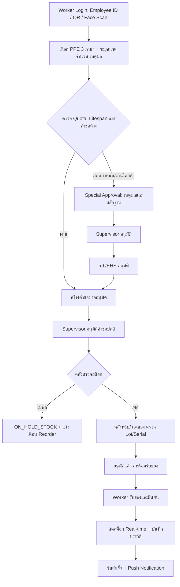
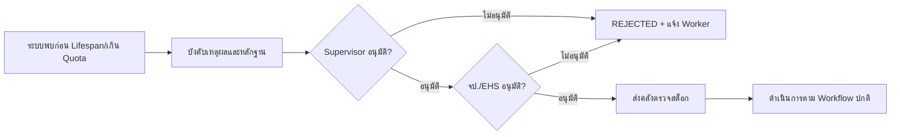

# Workflow Process: PPE Requisition & Issuance

## 1. ภาพรวมกระบวนการ

## 2. กระบวนการปกติแบบเป็นขั้นตอน

| ขั้น | ผู้รับผิดชอบ | การทำงาน | ผลลัพธ์/สถานะ |
|---:|---|---|---|
| 1 | Worker | ล็อกอิน เลือกภาษา และเปิด Catalog | พร้อมสร้างคำขอ |
| 2 | Worker | เลือก PPE ขนาด/จำนวน/เหตุผล แล้วส่ง | PENDING_APPROVAL |
| 3 | ระบบ | ตรวจสิทธิ์ Quota Lifespan คำขอซ้ำ และสต็อกเบื้องต้น | ผ่าน/แจ้งข้อผิดพลาด |
| 4 | Supervisor | ตรวจความจำเป็นและอนุมัติ/ปฏิเสธ | PENDING_APPROVAL หรือ REJECTED |
| 5 | คลัง/จป. | ตรวจ Policy/เอกสารและอนุมัติการจ่าย | APPROVED |
| 6 | Store Keeper | หยิบของตาม FIFO/FEFO ตรวจ Lot/Serial | READY_FOR_PICKUP |
| 7 | Worker/ผู้รับมอบอำนาจ | รับของ ตรวจรายการ และยืนยัน | COMPLETED |
| 8 | ระบบ | บันทึก Issue Transaction ตัดสต็อก และแจ้งเตือน | Audit ครบถ้วน |

## 3. กรณีเบิกก่อนกำหนดหรือเกินโควต้า

## 4. กรณีสต็อกไม่เพียงพอ
- ระบบไม่อนุญาตให้ยอดติดลบ
- คำขอเปลี่ยนเป็น `ON_HOLD_STOCK` พร้อมเหตุผลและวันที่คาดว่าจะมีของ
- แจ้ง Store Keeper, EHS และ Worker
- สร้าง/อัปเดต Reorder Alert เมื่อยอดต่ำกว่า Reorder Point
- เมื่อเติมสต็อกแล้ว คลังตรวจสอบคำขอค้างตามลำดับความเร่งด่วนและ Policy ก่อนเปลี่ยนเป็น `APPROVED`

## 5. จุดควบคุมสำหรับ Harness
1. คลังสแกน Serial Number และ Lot Number ขณะหยิบ/จ่าย
2. ตรวจวันตรวจสภาพและวันหมดอายุ ต้องอยู่ในสถานะใช้งานได้
3. ห้ามจ่าย Serial เดิมให้ผู้รับซ้ำโดยไม่มีการคืน/ปลดสถานะ
4. บันทึกผู้รับ วันที่จ่าย และรอบตรวจครั้งถัดไป
5. หาก Serial ไม่ตรงคำขอ ให้หยุดรายการและบันทึก Exception

## 6. Notification Events
| Event | ผู้รับ | ช่องทาง |
|---|---|---|
| สร้างคำขอ | Supervisor, คลัง/จป. | Push + In-app |
| ต้องอนุมัติพิเศษ | Supervisor, จป./EHS | Push + In-app |
| อนุมัติ/ปฏิเสธ | Worker | Push + In-app |
| พร้อมรับของ | Worker | Push + In-app |
| Stock ต่ำ | คลัง, EHS, ผู้บริหารตามสิทธิ์ | Push + Dashboard |
| รับสำเร็จ | Worker, Supervisor, คลัง | In-app + Audit |
