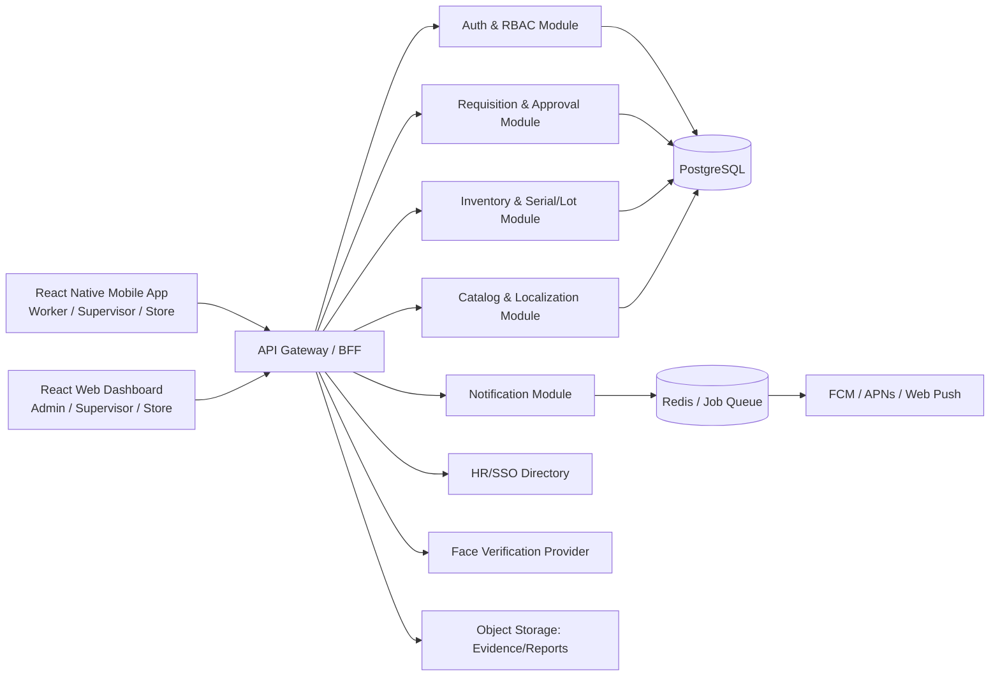
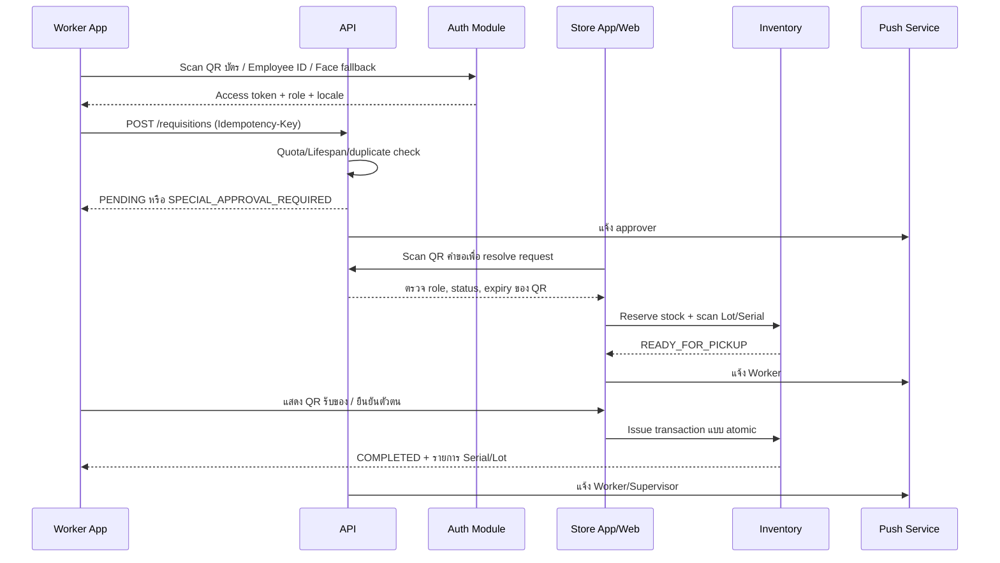

# System Architecture & Technical Design
## PPE Management System

## 1. Architecture Decision

แนะนำสถาปัตยกรรมแบบ **Modular Monolith + API-first** สำหรับระยะแรก โดยแยก Domain Module ชัดเจนและเปิด REST API ให้ Mobile/Web ใช้ร่วมกัน เมื่อปริมาณงานหรือทีมเติบโตจึงแยก Notification และ Reporting เป็น Service ได้โดยไม่เปลี่ยน Contract หลัก



## 2. Recommended Tech Stack

| Layer | Technology | เหตุผล |
|---|---|---|
| Mobile | React Native + TypeScript | ใช้ codebase เดียว Android/iOS, กล้อง/QR มี ecosystem พร้อม |
| Web | React + TypeScript + Vite | Dashboard เร็ว แยก bundle และใช้ component ร่วมได้ |
| UI/i18n | React Hook Form, TanStack Query, i18next | จัดการ form, cache, loading และ TH/EN/MY |
| Backend | Node.js + NestJS หรือ Fastify + TypeScript | Module/RBAC/Validation ชัด เหมาะกับ API แบบ transaction |
| ORM | Prisma | Type-safe schema/migration และ transaction API |
| Database | PostgreSQL | ACID, row locking, JSONB สำหรับ audit และค้นหาได้ดี |
| Cache/Queue | Redis + BullMQ | Idempotency, notification และงานรายงานแบบ async |
| Auth | OIDC/SSO หรือ Employee ID + OTP; JWT access + rotating refresh | รองรับองค์กรและ mobile session |
| QR | `react-native-vision-camera` + barcode plugin; Web `@zxing/browser` | กล้อง native และ browser fallback |
| Push | Firebase Cloud Messaging + APNs integration | Android/iOS/Web push ตามนโยบายองค์กร |
| Deployment | Docker, managed PostgreSQL, object storage, CI/CD | แยก environment และ rollback ได้ |
| Observability | OpenTelemetry, structured logs, metrics, error tracking | ตรวจ SLA, transaction และ notification failure |

## 3. Bounded Contexts และ Module

- **Identity:** Employee, Role, device session, QR challenge, face verification result
- **Catalog:** PPE item, translation, size, quota, lifespan, icon key, reorder policy
- **Requisition:** request/item, duplicate check, special approval, status transition
- **Inventory:** stock ledger, lot/serial, reservation, issue/return/adjustment
- **Notification:** event outbox, push token, retry และ delivery status
- **Audit:** append-only event สำหรับทุกการอนุมัติ/ตัดสต็อก/แก้ master data
- **Reporting:** read model/query แยกจาก transaction path เมื่อข้อมูลโตขึ้น

## 4. API Design

Base URL: `/api/v1` และทุก mutation รองรับ `Idempotency-Key`

| Method | Endpoint | สิทธิ์ | หน้าที่ |
|---|---|---|---|
| POST | `/auth/employee-id` | Public | Login ด้วย Employee ID/OTP |
| POST | `/auth/qr/challenge` | Public | สร้าง QR challenge อายุสั้น |
| POST | `/auth/qr/exchange` | Public | แลก challenge เป็น session หลัง verify |
| POST | `/auth/face/verify` | Public | ส่งผล/อ้างอิง Face verification ตาม privacy policy |
| GET | `/me` | Authenticated | โปรไฟล์และ role ของผู้ใช้ |
| GET | `/catalog/ppe?locale=th` | Authenticated | Catalog พร้อม stock/eligibility |
| POST | `/requisitions` | Worker/Supervisor | สร้างคำขอและรัน anti-duplicate |
| GET | `/requisitions` | Scoped role | ค้นคำขอตามสิทธิ์/status |
| GET | `/requisitions/:id` | Owner/Approver/Store | รายละเอียดและ approval history |
| POST | `/requisitions/:id/approvals` | Supervisor/EHS/Store | approve/reject/special approval |
| POST | `/requisitions/:id/prepare` | Store | reserve stock และเปลี่ยนพร้อมรับ |
| POST | `/requisitions/:id/issue` | Store | สแกน QR + serial/lot + issue transaction |
| POST | `/requisitions/:id/complete` | Worker/Delegate | ยืนยันรับของ |
| POST | `/inventory/receipts` | Store/Admin | รับเข้า stock และ lot/serial |
| GET | `/inventory/alerts` | Store/EHS/Admin | Reorder alerts |
| POST | `/inventory/scan/resolve` | Store | Resolve QR ของคำขอ/อุปกรณ์ |
| GET | `/dashboard/summary` | Supervisor/Store/EHS/Admin | KPI ตาม scope |

### ตัวอย่าง Request สร้างคำขอ

```json
{
  "items": [
    { "ppeItemId": "ppe-har", "size": "M", "quantity": 1, "reason": "DAMAGED" },
    { "ppeItemId": "ppe-n95", "quantity": 10, "reason": "NEW_EMPLOYEE" }
  ],
  "clientRequestId": "mobile-uuid",
  "locale": "th"
}
```

### ตัวอย่าง Response เมื่อพบการเบิกก่อนกำหนด

```json
{
  "requestId": "req_123",
  "status": "SPECIAL_APPROVAL_REQUIRED",
  "requires": ["SUPERVISOR", "EHS"],
  "violations": [
    { "ppeItemId": "ppe-har", "code": "LIFESPAN_NOT_EXPIRED", "eligibleAt": "2027-02-01T00:00:00Z" }
  ]
}
```

## 5. QR Code Workflow



**กติกา QR:** token ต้องเป็นแบบสุ่ม อายุสั้น ใช้ครั้งเดียวเมื่อเป็น QR รับของ ไม่ใส่ข้อมูลส่วนบุคคลโดยตรง และ API ต้องตรวจ role, request ownership, status และ replay ก่อนดำเนินการ

## 6. ความมั่นคงปลอดภัยและการปฏิบัติการ

- ใช้ short-lived access token, refresh token rotation, device revoke และ rate limit สำหรับ login/QR
- QR login ใช้ challenge-response; ห้ามยอมรับ QR ที่เป็น Employee ID แบบ plaintext เป็น credential
- Face Scan ให้ provider คืน verification result/ตัวอ้างอิงเท่าที่จำเป็น ไม่เก็บภาพดิบโดยค่าเริ่มต้น
- ใช้ PostgreSQL transaction + row lock เมื่อ reserve/issue stock; ทุก mutation มี idempotency
- ใช้ Outbox Pattern สำหรับ Push หลัง commit เพื่อไม่ให้ transaction สำเร็จแต่แจ้งเตือนไม่ออก
- Encrypt secret/PII, mask Employee ID ใน log, แยกสิทธิ์ production และทดสอบ restore backup
- Metrics หลัก: API latency P95, duplicate blocked, approval SLA, stock accuracy, push failure, QR replay blocked

## 7. Deployment Environments

`dev` -> `staging` -> `pilot` -> `production` โดย migration ต้องรันแบบ backward-compatible และมี rollback plan; Mobile release ใช้ staged rollout ส่วน Web ใช้ blue/green หรือ rolling deployment

## 8. ตัวอย่างไฟล์อ้างอิง

- Prisma schema: [../prisma/schema.prisma](../prisma/schema.prisma)
- QR scanner: [../examples/qr-scan.ts](../examples/qr-scan.ts)
- Anti-duplicate service: [../examples/anti-duplicate.ts](../examples/anti-duplicate.ts)
